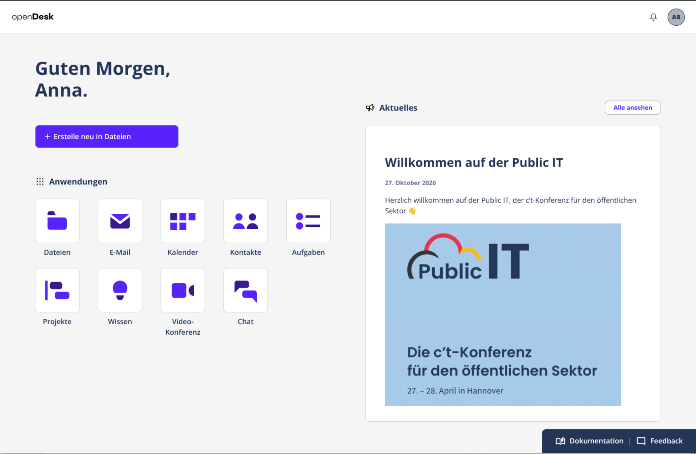
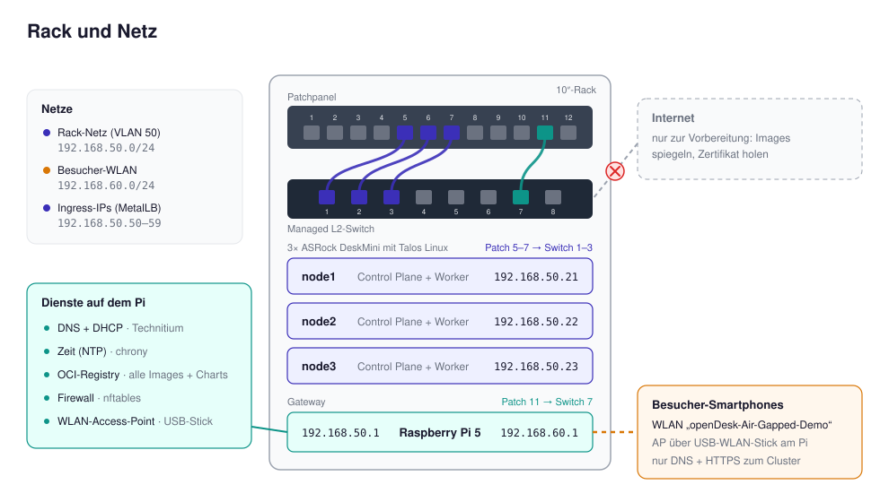
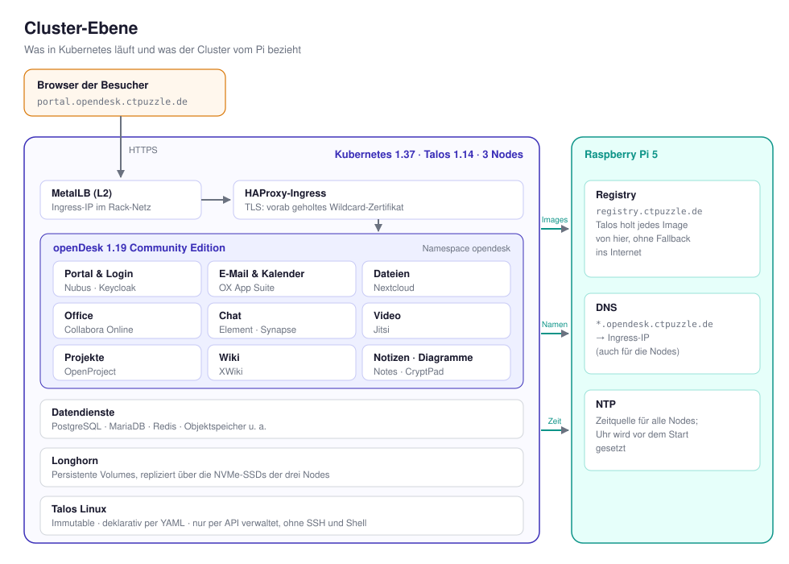

# Air-Gapped-openDesk

Ein transportables 10-Zoll-Rack, auf dem [openDesk](https://www.opendesk.eu/) vollständig ohne Internetverbindung läuft. Gebaut als Live-Demo die [Public IT](https://public-it.de/): Besucher verbinden ihr Smartphone mit dem WLAN-AP und können E-Mail, Dateien, Office, Projekte, Aufgaben und Videokonferenz ausprobieren.

> **Hinweis:** Dies ist ein Demo-Aufbau, keine Anleitung für den produktiven Betrieb. Abschnitt [Grenzen](#grenzen-der-demo) nennt, was bewusst fehlt.

## Was die Demo zeigt

- Eine komplette openDesk-Installation (Community Edition 1.19) auf drei Kubernetes-Nodes.
- Rack und verbundene Geräte haben keinen Internetzugang. Container-Images, Helm-Charts, DNS, NTP und TLS-Zertifikat stecken im Rack.
- Besucher nutzen die Oberfläche über ein eigenes WLAN, das nur DNS und HTTPS zum Cluster durchlässt.

## Hardware

| Komponente | Rolle |
|---|---|
| 3× ASRock DeskMini (Ryzen 5 8600G, 32 GB RAM, 2 TB NVMe) | Kubernetes-Nodes mit Talos Linux |
| Raspberry Pi 5 mit NVMe | Gateway: DNS, DHCP, Zeit, Image-Registry, Firewall, WLAN-Access-Point |
| USB-WLAN-Stick | Access Point für das Besucher-WLAN |
| Managed L2-Switch, 8 Ports (Digitus) | Rack-Netz |
| Patchpanel, 12 Ports | Verkabelung |
| 10-Zoll-Rack (DeskPi RackMate T2) mit Fachböden | Gehäuse und Strom |

## Aufbau des Racks

Das Rack hat zwei Netze. Im **Rack-Netz** (VLAN 50, `192.168.50.0/24`) hängen die drei Talos-Nodes und der Raspberry Pi. Das **Besucher-WLAN** (`192.168.60.0/24`) spannt der Pi über einen USB-Stick auf. Eine nftables-Firewall auf dem Pi lässt aus dem WLAN nur DNS-Anfragen an den Pi und HTTPS zur Ingress-IP des Clusters durch. Die Verwaltungsoberflächen des Pi sind für Besucher nicht erreichbar.

## Der Cluster

Die drei Nodes laufen mit [Talos Linux](https://www.talos.dev/) 1.14 und Kubernetes 1.37. Talos ist ein Betriebssystem speziell für Kubernetes: Das System ist schreibgeschützt (immutable) und es gibt weder SSH noch Shell. Die gesamte Konfiguration steht deklarativ in YAML-Dateien und wird mittels `talosctl` über ein API eingespielt. Für ein Air-Gap-Setup ist das praktisch, denn es gibt keine Paketverwaltung oder andere Dienste, die nach außenen telefonieren, und jede Talos-Node lässt sich aus seiner Konfigurationsdatei reproduzierbar neu aufsetzen. Alle drei sind gleichzeitig Control Plane und Worker (HA nicht getestet).

Eine Anfrage aus dem Browser nimmt diesen Weg:

1. Der DNS-Server auf dem Pi löst `*.opendesk.ctpuzzle.de` zur Ingress-IP auf.
2. MetalLB kündigt diese IP im Rack-Netz per ARP an.
3. HAProxy-Ingress terminiert TLS mit einem echten Let's-Encrypt-Wildcard-Zertifikat und verteilt an die openDesk-Dienste.
4. Persistente Daten liegen in Longhorn-Volumes, die über die NVMe-SSDs der drei Nodes repliziert werden.

Jedes Container-Image bezieht Talos aus der Registry (`docker.io/library/registry:2`) auf dem Pi. Die Registry-Spiegel sind so konfiguriert, dass es keinen Rückfall auf die Original-Registries gibt: Fehlt ein Image, schlägt der Start sofort und sichtbar fehl, statt heimlich ins Internet zu greifen.

## Vorgehen

1. **Inventur und Spiegel.** Aus dem openDesk-Release wurde die Liste aller Images und Charts erzeugt: gut 100 Images und 50 Helm-Charts für openDesk, dazu Images für Talos und die Basis-Infrastruktur. `skopeo` hat sie per Digest in eine Registry (`docker.io/library/registry:2`) kopiert, zusammen rund 18 GB.
2. **Zertifikate vorab.** Die Zertifikate für `registry.ctpuzzle.de` und `*.opendesk.ctpuzzle.de` kamen per DNS-01-Challenge von Let's Encrypt. Das funktioniert, weil der Nachweis über einen DNS-Eintrag läuft und der Server selbst nicht erreichbar sein muss.
3. **Gateway.** Auf dem Pi laufen Technitium (DNS und DHCP), chrony als lokaler Zeitserver und die Registry als Podman-Container.
4. **Talos-Cluster.** Die Nodes booten von einem ISO aus der Talos Image Factory mit den Erweiterungen (`siderolabs/iscsi-tools` und `siderolabs/util-linux-tools`), die Longhorn braucht. Registry-Spiegel, DNS- und Zeitserver zeigen per Maschinenkonfiguration auf den Pi.
5. **Basis-Infrastruktur und openDesk.** MetalLB, HAProxy-Ingress und Longhorn per Helm, danach openDesk per `helmfile` mit einer eigenen Umgebungsdatei. Diese stellt das Chart-Repository auf den Spiegel um, setzt das vorhandene Zertifikat und die Storage-Klassen und schaltet den Virenscanner ab.
6. **Besucher-WLAN und Härtetest.** Access Point und Firewall auf dem Pi, dann der Kaltstart: Uplink ziehen, alles aus- und wieder einschalten.

## Grenzen der Demo

- **Ein Gateway.** Der Pi ist ein Single Point of Failure für DNS, DHCP, NTP und Images.
- **Kein Virenscanner.** ClamAV ist abgeschaltet, weil Virensignaturen aus dem Internet gefischt werden. Ein echter Air-Gap-Betrieb bräuchte einen internen Spiegel für die Signaturen.
- **Keine Kommunikation nach außen.** Mail verlässt das Rack nicht, und für Videokonferenzen gibt es keinen TURN-Server.
- **Keine Updates.** Neue openDesk-Versionen und Sicherheitsupdates müssen wie beim Erstaufbau gespiegelt und eingespielt werden.

## Versionen

| Komponente | Version |
|---|---|
| openDesk (Community Edition) | 1.19.2 |
| Talos Linux | 1.14.4 |
| Kubernetes | 1.37.1 |
| MetalLB | 0.14.9 |
| HAProxy-Ingress (Chart) | 0.16.3 |
| Helm | 3.x (nicht 4) |
